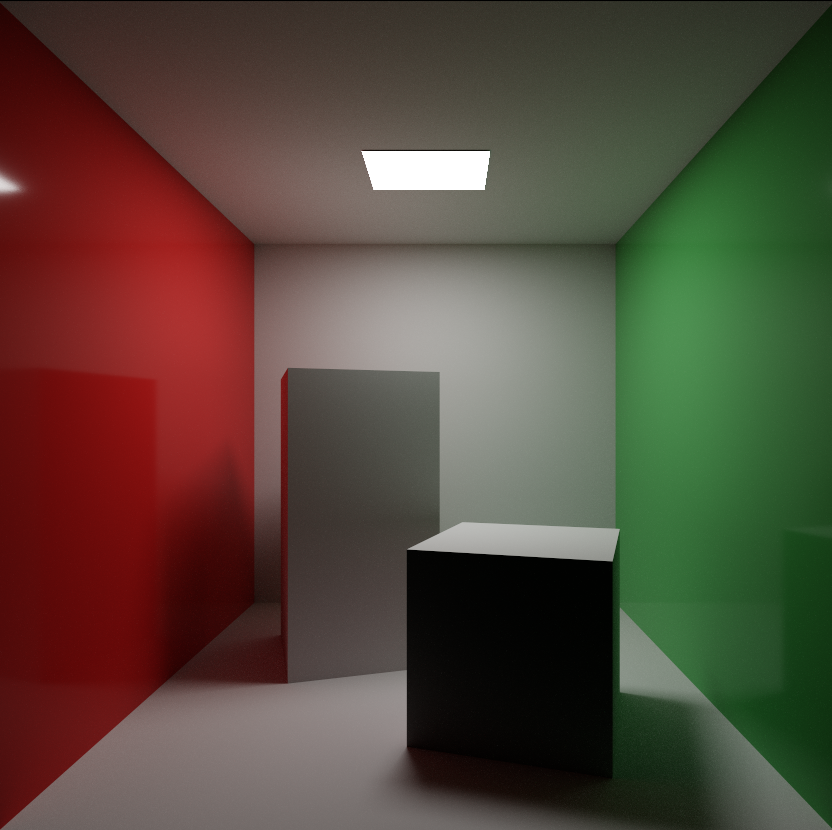
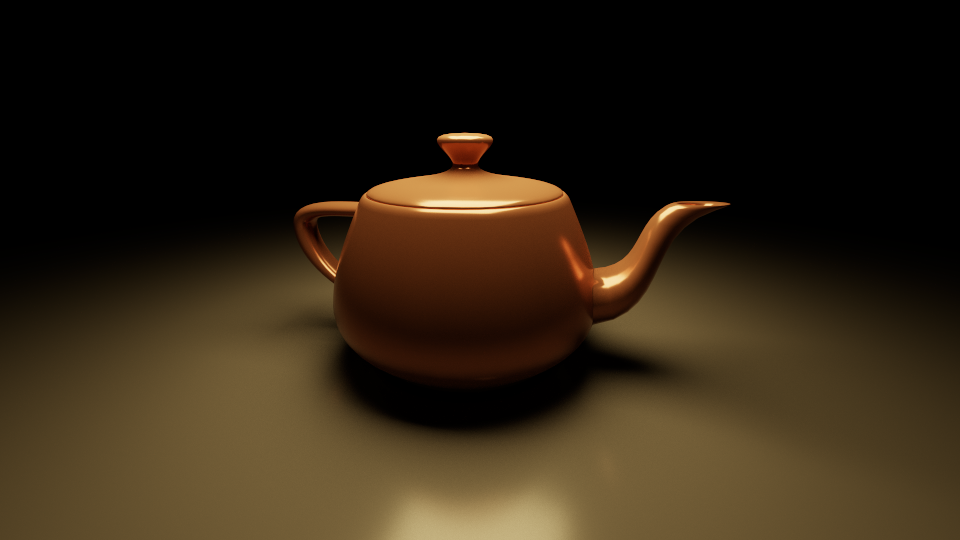
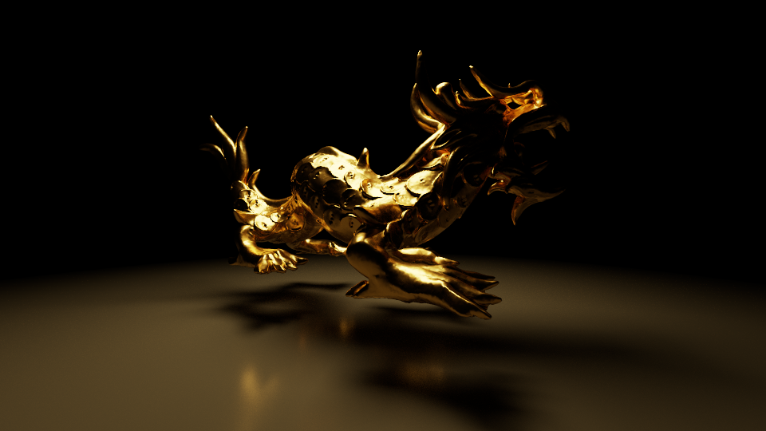
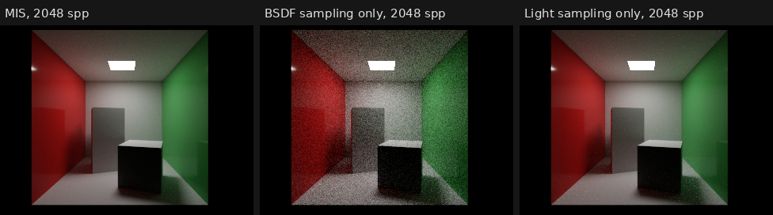
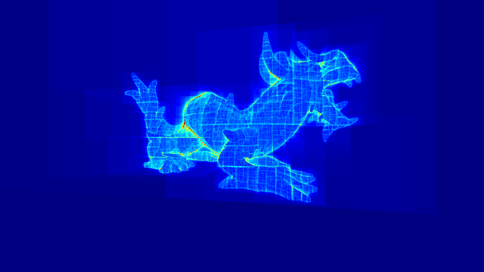
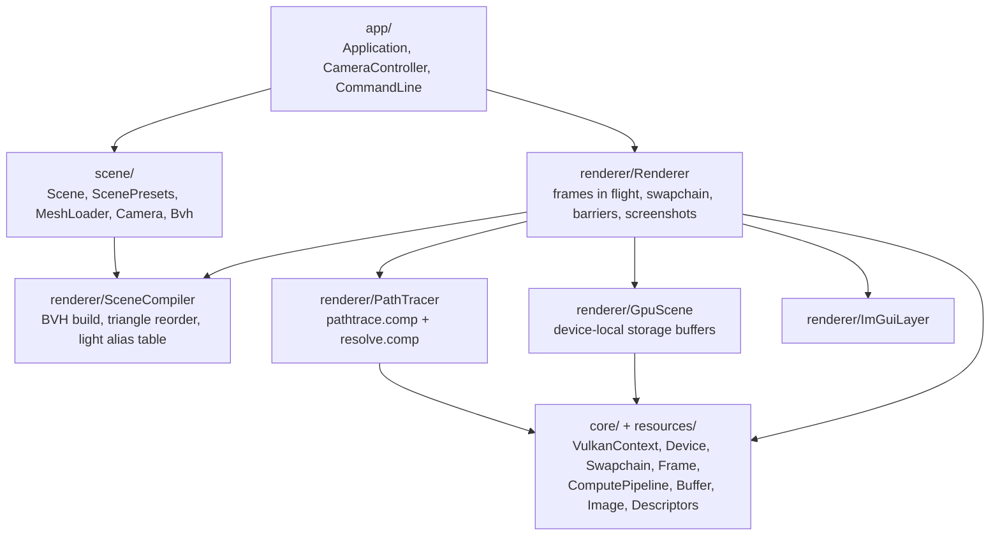

# Vulkan Path Tracer

A progressive, physically based path tracer that runs entirely in Vulkan compute shaders, written
in C++20. It combines BSDF and light sampling with multiple importance sampling, uses a GGX
microfacet BSDF with visible-normal sampling, and traverses a binned-SAH BVH built on the CPU.



| Utah teapot | Stanford dragon (250k triangles) |
| :---: | :---: |
|  |  |

## Features

**Light transport**
- Unidirectional path tracing with next-event estimation. Emitters reached by BSDF sampling and by
  light sampling are combined with multiple importance sampling (power heuristic).
- Metal/roughness BSDF: Lambert diffuse plus GGX specular with Smith shadowing. Specular
  directions come from visible-normal sampling (Heitz 2018); one lobe is picked per bounce and
  the estimator uses the pdf of the whole lobe mixture, so MIS weights stay consistent.
- Emissive triangles as area lights, chosen in proportion to their power through an alias table
  (O(1) per sample) and sampled uniformly by area.
- Russian roulette, progressive accumulation in a 32-bit float image, exposure and ACES tone
  mapping in a separate pass so adjusting exposure never restarts the render.

**Acceleration structure**
- Top-down binned SAH BVH (16 bins per axis) with 32-byte nodes and adjacent siblings.
- Front-to-back traversal: the nearer child is visited first and pushed subtrees are skipped once
  a closer hit is found. Shadow rays exit on the first hit.

**Vulkan**
- Vulkan 1.3 with synchronization2 and dynamic rendering, memory through VMA, two frames in
  flight. Every barrier states its full dependency and the frame is clean under synchronization
  validation.
- The renderer is compute only: `pathtrace.comp` → `resolve.comp` → blit to the swapchain →
  Dear ImGui overlay.

**Tooling**
- In-app panel: scene presets, camera, bounce count, sample budget, exposure, vsync, GPU timings,
  BVH statistics and PNG screenshots.
- Switchable integrators (MIS, BSDF only, light only) and a BVH traversal heatmap for debugging.
- Command-line rendering to PNG, so every image in this README can be reproduced.
- CPU unit tests for the BVH, the light sampling table and scene compilation.

## Verification

**The estimators agree.** BSDF sampling, light sampling and MIS are three unbiased estimators of
the same integral, so they must converge to the same image; only their noise differs. Comparing
them checks every pdf and MIS weight in the integrator. On the Cornell box at 2048 spp, their mean
brightness agrees to within half a percent, and the noise behaves as expected:
BSDF sampling struggles to find the small light, light sampling produces fireflies on the glossy
walls, and MIS avoids both.



**The BVH matches brute force.** The tests build trees over random, clustered, degenerate and
empty inputs and check structural invariants (every primitive in exactly one leaf, children
contained in parents). They then cast 5,000 rays through a CPU port of the shader's traversal and
compare every hit against brute-force intersection, with zero mismatches.

**SAH pays off.** Expected traversal cost (SAH metric, lower is better) against an object-median
split on 20k triangles:

| Distribution | Binned SAH | Median split |
| --- | ---: | ---: |
| Uniform | 71.8 | 92.2 |
| Clustered | 15.9 | 18.0 |

The heatmap view shows how many BVH nodes each primary ray visits:



## Architecture



The CPU side (`scene/` and `SceneCompiler`) contains no Vulkan code and builds as its own library,
`pt_scene`, which the unit tests link without a GPU.

Each frame:

1. **Path trace.** `pathtrace.comp` traces *N* samples per pixel and adds them to the RGBA32F
   accumulation image. Once the target sample count is reached the dispatch is skipped and the
   app sleeps until there is input.
2. **Resolve.** `resolve.comp` averages, applies exposure and ACES, sRGB-encodes, and writes an
   RGBA8 display image.
3. **Present.** The display image is blitted to the swapchain (a blit converts RGBA to BGRA where
   needed) and ImGui draws on top with dynamic rendering. Only the blit waits on the
   swapchain-acquire semaphore, so the compute passes overlap with presentation.

Push constants carry the camera and per-frame parameters, so there is no per-frame uniform
buffer to synchronise.

| Path | Contents |
| --- | --- |
| `include/`, `src/` | Headers and sources, one folder per layer as above |
| `shaders/` | `pathtrace.comp`, `resolve.comp`, plus includes: `bsdf`, `intersect`, `sampling`, `random`, `scene`, `common` |
| `tests/` | CPU unit tests (CTest) |
| `assets/` | OBJ models |
| `external/` | Vendored Dear ImGui and tinyobjloader |

## Building

You need:
- The [Vulkan SDK](https://vulkan.lunarg.com) 1.3 or newer, which provides the loader, headers,
  `glslc` and the validation layers.
- CMake 3.24 or newer and Ninja.
- A C++20 compiler: MSVC 2022, GCC 13 or Clang 17.

### Windows (Visual Studio + vcpkg)

Set `VCPKG_ROOT` to your vcpkg checkout. The dependencies in `vcpkg.json` are installed on the
first configure.

```bat
cmake --preset windows-release
cmake --build --preset windows-release
build\windows-release\bin\PathTracer.exe
```

Visual Studio picks up `CMakePresets.json` when you open the folder.

### Linux

```sh
sudo apt install cmake ninja-build g++ libvulkan-dev glslc \
    libglfw3-dev libglm-dev libvulkan-memory-allocator-dev libstb-dev
cmake --preset linux-release
cmake --build --preset linux-release
./build/linux-release/bin/PathTracer
```

Tests: `ctest --preset linux-debug` (or `windows-debug`).

## Usage

| Input | Action |
| --- | --- |
| `W` `A` `S` `D` | Move |
| `Q` / `E` | Down / up |
| Arrow keys or right-drag | Look |
| `Shift` | Move faster |

```text
PathTracer [options]
  --scene <id>          cornell | teapot | dragon
  --size <W>x<H>        window size (default 1280x720)
  --spp <n>             target samples per pixel (default 1024)
  --spf <n>             samples per pixel per frame (default 1)
  --bounces <n>         maximum path length in bounces (default 8)
  --integrator <name>   mis | bsdf | light | heatmap
  --exposure <x>        exposure multiplier
  --vsync               FIFO presentation
  --screenshot <file>   render to --spp, save a PNG, and exit
  --validation          enable the Vulkan validation layer
  --sync-validation     also enable synchronization validation
```

To reproduce the images above:

```sh
PathTracer --scene cornell --size 1280x720 --spp 4096 --spf 16 --screenshot docs/images/cornell.png
PathTracer --scene dragon  --size 960x540  --spp 8 --integrator heatmap --screenshot docs/images/bvh-heatmap.png
```

## References

- E. Veach, *Robust Monte Carlo Methods for Light Transport Simulation*, PhD thesis, 1997 (MIS)
- M. Pharr, W. Jakob, G. Humphreys, *Physically Based Rendering*, 4th ed.
- B. Walter et al., "Microfacet Models for Refraction through Rough Surfaces", EGSR 2007
- E. Heitz, "Sampling the GGX Distribution of Visible Normals", JCGT 2018
- I. Wald, "On Fast Construction of SAH-based Bounding Volume Hierarchies", IRT 2007
- M. Vose, "A Linear Algorithm for Generating Random Numbers with a Given Distribution", 1991
- T. Duff et al., "Building an Orthonormal Basis, Revisited", JCGT 2017
- M. Jarzynski, M. Olano, "Hash Functions for GPU Rendering", JCGT 2020 (PCG hash)
- E. Haines et al., "Precision Improvements for Ray/Sphere Intersection", *Ray Tracing Gems*, 2019
- K. Narkowicz, "ACES Filmic Tone Mapping Curve", 2015

Libraries: [Dear ImGui](https://github.com/ocornut/imgui), [GLFW](https://www.glfw.org),
[GLM](https://github.com/g-truc/glm),
[Vulkan Memory Allocator](https://github.com/GPUOpen-LibrariesAndSDKs/VulkanMemoryAllocator),
[tinyobjloader](https://github.com/tinyobjloader/tinyobjloader), [stb](https://github.com/nothings/stb).
The Stanford dragon is from the [Stanford 3D Scanning Repository](https://graphics.stanford.edu/data/3Dscanrep/).

## License

[MIT](LICENSE)
